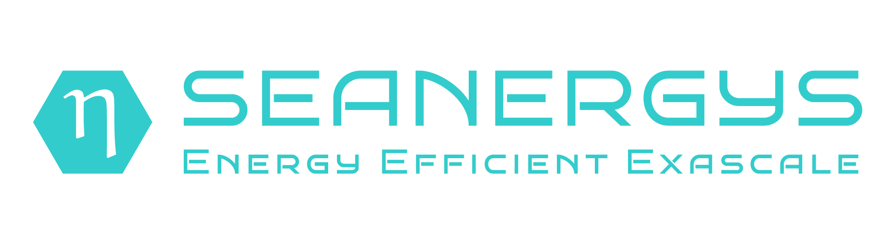

# SEANERGYS Public Software Repository
Software for Efficient and Energy-Aware Supercomputers

](https://seanergys.eu/)

In this GitHub Org [SEANERGYS](https://seanergys.eu/) publishes software.
For additional information, please visit [our website](https://seanergys.eu/).

We develop in an internal github, and mirror software here.
The repositories are a mix of original software, and patched/extended versions of pre-existing software.

## Usage
During development, some links into our internal GitLab may linger in the code.
To use the software published here, please configure:

```bash
git config --global --add url.'https://github.com/seanergys/'.insteadOf 'https://gitlab.seanergys.fz-juelich.de/software/'
git config --global --add url.'https://github.com/seanergys/'.insteadOf 'git@gitlab.seanergys.fz-juelich.de:software/'
```

